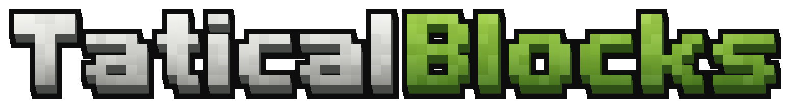

# TaticalBlocks

<p align="center"></p>

FPS voxel em primeira pessoa com Three.js (Vite + TypeScript) e servidor NestJS.

## Rodar

```bash
npm install
npm run dev        # sobe server (:3000) e client (:5173) juntos
```

Abra http://localhost:5173: o **menu principal** tem o nome do jogador no topo, os botões **Jogar Online**, **Jogar Zombie Solo** e **Configuração** e, à direita, três soldados 3D (o principal na frente e dois atrás) com armas sorteadas a cada carregamento da página; o fundo é sólido e o jogo nem é desenhado enquanto o menu está aberto (`client/src/ui/main/`). **Jogar Online** recolhe os botões para a esquerda, a câmera leva os soldados para a esquerda e a lista de servidores (todas as salas, partida rápida e criar sala por modo) entra pela direita; **—** recolhe a lista. Escolher uma sala abre o jogo online já entrando nela. **Esc** abre a pausa: painel lateral à esquerda com o nome do jogador, **Menu Principal**, **Configurações** e, embaixo, **Sair da partida** (volta ao menu principal; no online desconecta). O jogo fica visível à direita — clicar nele retoma. Se o servidor estiver fora do ar, o cliente usa um mapa local.

| Tecla | Ação |
|---|---|
| WASD | mover |
| Shift | correr |
| Espaço | pular |
| Mouse esq. | atirar |
| Mouse dir. | mirar |
| R | recarregar |
| 1 2 3 4 | principal / secundária / branca / granada |
| Roda do mouse / X | próxima arma / última arma |
| Q / E | inclinar a cabeça para a esquerda / direita |
| V | inspecionar a arma (mostra a munição) |
| C | agachar / levantar (alterna) |
| Espaço (segurar no ar) | agarrar a quina à frente · **W** escala · soltar Espaço ou **S** cai |
| B / Esc | abrir / fechar o Arsenal (menu radial) |


### Docker

```bash
docker compose up -d --build   # imagem única: jogo + API + online
```

Abra http://localhost:3260. Um só contêiner roda o servidor NestJS, que entrega o jogo compilado em `/`, a API em `/api` e o WebSocket do online em `/server`. Para outra porta: `TB_PORT=8080 docker compose up -d`. A imagem (`Dockerfile`, multi-stage em `node:22-alpine`) compila cliente e servidor e leva só as dependências de produção, com *healthcheck* em `/api/health`.

### Logo

`client/public/logo.svg` e `favicon.svg` são gerados por `node scripts/gen-logo.mjs` (letras em blocos, face com gradiente, extrusão e contorno).
## Arsenal

31 armas em 8 categorias, cada uma com tier (Comum → Lendária), modelo voxel próprio e
animação de recarga personalizada. Loadout: 1 principal, 1 secundária, 1 arma branca e até
5 granadas de um único tipo — validado no cliente e no servidor (`shared/weapons/loadout.ts`).

| Categoria | Armas |
|---|---|
| Pistolas | G17, G17 Inox, G34 Competição, G19 FDE, Revólver .357 |
| Submetralhadoras | MP7, MP5K, TMP, MAC-10, UMP-45, P90 |
| Fuzis | M4A1, AK-47, M16A4 (rajada), HK416 |
| Escopetas | Escopeta 870, M590 Shorty, AA-12 |
| Precisão | Rifle de Caça, AWM, SR-25 DMR |
| Pesadas | M249, Minigun M134, RPG-7, M32 MGL |
| Brancas | Faca de Combate, Machadinha, Marreta |
| Arremessáveis | Fragmentação, Atordoamento, Molotov |

## Mapa "Pátio Voxel"

Mapa padrão (`shared/map/voxelYard.ts`, usado pelo servidor e pelo modo offline), todo em voxel e destrutível, com borda indestrutível. Arena **PvP 1v1** com simetria de ponto (girada 180° em torno do centro: as duas bases têm exatamente as mesmas rotas e coberturas):

- **Borda invisível**: paredes de colisão altas na borda; não dá para sair do mapa escalando.
- **Bases** azul (sul, spawn) e verde (norte): sala em U com saída central e portas laterais, faixa e pilares na cor do time, muretas logo na saída.
- **Meio**: bunker de concreto com teto, janelas alinhadas à rota central e portas laterais; muretas, caixotes e pilares de aproximação.
- **Rotas laterais**: barracão de madeira atravessável de um lado, corredor de contêineres (um oco aberto, um fechado para subir pela quina) do outro; divisórias com janela baixa ligando as rotas.
- **Blocos de madeira voxel** (destrutíveis) espelhados no lugar dos antigos caixotes com física (`crates: []`). O gerador aleatório antigo continua em `GET /api/map?mode=classic`.

### Materiais

| Material | Vida/voxel | Comportamento |
|---|---|---|
| Plástico | 1 | estilhaça fácil, pedaços coloridos e leves; vão máx. 1,5 m |
| Madeira | 2 | tábuas visíveis, lascas; vão máx. 3,5 m |
| Concreto | 4 | resistente, poeira; vão máx. 5 m |
| Metal | 10 | amassa/escurece antes de furar, faíscas, chapa ondulada; vão máx. 6 m |

Dano do tiro ≈ dano da arma ÷ 10 por voxel, caindo com a distância ao ponto de impacto. Blocos se apoiam no chão ou em voxels de outros blocos (embaixo ou ao lado); o que perde apoio ou passa do vão máximo do material desaba em cascata. Ajustes em `client/src/world/destruction/materials.ts`.

## Destruição e física

- **Blocos destrutíveis**: cada caixa do mapa vira uma grade de voxels (~25 cm) no primeiro dano. Tiros abrem crateras irregulares (raio cresce com o dano da arma), golpes cavam, explosões arrancam pedaços grandes. O que perde apoio desaba. Voxels removidos viram detritos com física + poeira; o miolo exposto é mais escuro (profundidade). Colisão, escalada e raycast seguem os voxels que restam. Paredes externas são indestrutíveis.
- **Caixas de madeira** (`cannon-es`): pilhas e caixas soltas que caem, tombam, recebem impulso no ponto do tiro, são arremessadas por explosões, podem ser empurradas andando e servem de plataforma.

Código: `client/src/world/destruction/` (`VoxelBlock`, `DestructionSystem`), `client/src/world/Crates.ts`, `client/src/physics/`.

## HUD

Durante o jogo só a mira aparece. A munição é vista inspecionando a arma (**V**): a arma gira na mão e um número flutua ao lado dela com o cartucho daquela arma girando (GIFs `ammo_*.gif`, gerados em `/tools/gifs.html` → *Renderizar cartuchos*). Granadas mostram quantas restam.

**Foco ao mirar:** um túnel de foco (vinheta) escurece as bordas e fecha conforme o jogador fica parado mirando (~2,5 s até o máximo; andar abre). A arma é composta com desfoque leve, exceto um pequeno círculo nítido no centro: a massa de mira fica nítida e a alça de mira/corpo da arma levemente desfocados (`client/src/core/ViewmodelFocus.ts`). Fora da mira não há custo extra.

## Acessórios (T)

Aperte **T**: o personagem segura a arma perto da câmera (de lado, cano para a esquerda, balançando de leve; pistolas só na mão direita), o fundo desfoca e de cada encaixe da arma sai uma linha até um quadrado com o acessório atual (GIF girando). Clicar no quadrado abre a fileira de opções (como os arremessáveis do arsenal): passar o mouse troca na hora no modelo, só clicar escolhe — a opção escolhida fica destacada e o quadrado muda. Embaixo aparecem o nome da arma, os atributos e a descrição da opção sob o mouse. Os GIFs dos acessórios (`att_*.gif`) são gerados em `/tools/gifs.html` → *Renderizar acessórios* (`client/src/weapons/models/attachmentPreview.ts`). **T** ou **Esc** volta. Toda arma começa sem nada; a escolha fica salva por arma no navegador.

| Encaixe | Opções | Efeito |
|---|---|---|
| Mira | Holográfica (1x), COG (3,5x, corpo sextavado, só o chevron), Luneta 2x | alça/massa saem do modelo; a mira passa a ser a da óptica (sem desfoque de ferro). Na M249 a mira vai na tampa e sobe junto na recarga |
| Boca do cano | Silenciador | tiro abafado e sem clarão, recuo −8%; online: mais baixo de longe |
| Pente | Estendido | +50% de munição |
| Trilho lateral | Lanterna, Laser | a luz sai do módulo preso na arma / traço vermelho curto preso à arma, passando um pouco da boca do cano, com intensidade oscilando em loop (ruído de Perlin 1D; sem ponto no cenário) e −35% de dispersão no quadril |
| Empunhadura | Vertical, Angulada | −20% recuo vertical / −25% recuo lateral; a mão esquerda vai para a empunhadura |

Compatibilidade (`shared/weapons/attachments.ts`): miras só em armas com mira de ferro (pistolas e submetralhadoras: só holográfica); silenciador em pistolas, submetralhadoras, fuzis (menos AK-47) e snipers; pente estendido só em armas de pente (menos P90 e M249); empunhaduras em fuzis, escopetas e M249 (submetralhadoras não). Listas fechadas: revólver nada, Remington 870 só lanterna, M590 só holográfica. Lança-foguetes/granadas e minigun não aceitam nada. HK416 e P90 vêm só com alça e massa. No online os outros veem os acessórios na sua arma.

## Inspeção (V)

A arma gira e a mão esquerda tira o pente para conferir: a munição só aparece com o pente fora, junto com a lista de acessórios equipados. Armas sem pente destacável (revólver, escopetas de tubo, M249) mostram a munição na metade do giro. Pistolas ficam levemente inclinadas para cima.

## Morte

Ao morrer, a câmera vira um corpo físico (cannon-es) que cai, quica e rola pelo chão, empurrado na
direção do tiro que matou. Quando para, a visão se acomoda deitada de lado. Arma, pernas e mira somem
até renascer: 3 s no offline, e o tempo do servidor no online. Código: `client/src/player/DeathCam.ts`.

## Saltar obstáculos

Apertando **Espaço** de frente para algo de até 60% da sua altura (≈1,05 m), o jogador passa por cima num arco curto; se o obstáculo for fundo, sobe nele. Código: `client/src/player/Vault.ts`.

## Deslize

Correndo (Shift+W) no chão, aperte **C**: o jogador desliza para a frente (≈1,3× a velocidade de corrida, freando em ~0,9 s, dá para corrigir um pouco a direção) e termina **agachado** — Shift+W segurado não o levanta até soltar. Espaço no deslize pula com o embalo. Câmera baixa e inclina, FOV abre, poeira e som de atrito; a arma inclina (mirando, gira em torno da visada). No online, os outros veem o soldado deslizando (perna da frente esticada, a de trás dobrada, tronco para trás).

## Modo online (PvP)

Pelo menu principal (**Jogar Online**) — tudo na mesma rota `/`, sem parâmetro no endereço (a sala escolhida vai para o próximo carregamento via `sessionStorage`; recarregar de novo volta ao menu). Escolha o nome e o modo e entre por partida rápida, criando uma sala ou pela lista — que mostra **todas** as salas de todos os modos (com etiqueta do modo), independente do modo selecionado. Só o Pátio Voxel é jogável online.

| Modo | Jogadores | Como vence |
|---|---|---|
| 1v1 / 5v5 / 10v10 | times Verde × Azul | primeiro time a 10 / 40 / 75 abates (ou mais abates em 10 min) |
| **1 contra todos** | até 12, cada um por si | primeiro a 20 abates (ou o líder em 10 min) |
| **Gun Game** | até 12, cada um por si | cada abate troca sua arma pela próxima da escada (M4 → AK → HK416 → MP7 → P90 → 870 → AA-12 → SR-25 → AWM → M249 → revólver → G17 → faca); vence quem matar com a faca. Abate de faca rebaixa a vítima um nível |

No Gun Game o servidor impõe a arma (só ela e a faca causam dano) e o menu de loadout (B) fica bloqueado; o nível aparece embaixo da tela. Nos modos sem times não há aliados: todos são alvo, os uniformes alternam verde/azul só no visual e o renascimento sorteia entre todos os pontos do mapa.

- **Servidor**: NestJS + WebSocket (`@nestjs/platform-ws`) em `ws://<host>:3000/server` — mesma porta da API; o Vite repassa `/server` (funciona pelo ngrok). Código em `server/src/game/` e protocolo em `shared/net/`.
- **Fim e reinício**: ao fim da partida aparece **VITÓRIA**, **DERROTA** ou **EMPATE** com o placar; na próxima partida há uma contagem **3-2-1** (todos parados, sem dano) e o mapa é **restaurado** — voxels de volta, sem buracos, marcas nem detritos — e então "VALENDO!".
- **Times** Verde × Azul, com uniforme camuflado da cor do time (inclusive os seus braços e pernas). Partida por abates (10 / 40 / 75) ou 10 min; renascimento em 3 s num ponto sorteado da base (evitando inimigos a menos de 12 m) com **3 s de proteção** (imortal e semitransparente para os outros, com o aviso "PROTEGIDO" na sua tela — contra spawn kill); sem fogo amigo.
- **Personagem**: os outros jogadores aparecem como soldados voxel (capacete, colete, braçadeira do time) com animação procedural — parado, andar/correr em 8 direções, agachar, pulo, inclinação Q/E, olhar para cima/baixo, mira × quadril × arma baixa na corrida, recuo, recarga, troca de arma, golpe, arremesso, tranco ao levar tiro e ragdoll na morte. Mãos presas à arma por IK. Você continua vendo só seus braços, pés e tronco.
- **Dano por parte do corpo** (mais sensível que o zumbi, vida 100): cabeça ×4, pescoço ×2,6, tronco ×1,35, cintura ×1,2, quadril ×1,1, ombro/coxa ×1, antebraço/joelho ×0,85–0,9, perna ×0,85, mão/pé ×0,7. O cliente detecta o acerto; o **servidor** confere (tiro registrado, cadência da arma, alcance, balins por disparo, time) e calcula o dano pelo catálogo. Explosões e fogo também são calculados no servidor.
- Tiros, destruição do cenário (ruído determinístico) e projéteis são reproduzidos nos outros clientes. **Tab** mostra a tabela; feed de abates, marcador de acerto, nomes dos aliados sempre visíveis (inimigos nunca têm nome) e vida na tela.
- **Som posicional**: tiros e passos dos outros jogadores vêm do lado certo (panorâmica estéreo), abafam e diminuem com a distância. Agachado quase não faz barulho; silenciador alcança bem menos.
- **Direção do dano**: ao ser atingido (online ou por zumbi), uma meia-lua vermelha em volta da mira aponta para quem atacou e acompanha quando você vira.
- **Bot de teste**: `npm run bot` (1v1), `npm run bot -- 5v5 4` (4 bots) ou `npm run bot -- 1v1 1 <id-da-sala>`. Os bots só andam, miram e atiram (não acertam).
- Limitações: caixas com física não são sincronizadas; buracos podem divergir levemente em tiros simultâneos.

## Desempenho

- **Zumbis instanciados** (`client/src/enemies/zombie/ZombieInstancer.ts`): as malhas de cada zumbi continuam existindo (ossos, raycast dos tiros, desmembramento, ragdoll), mas ficam invisíveis; um `InstancedMesh` por material desenha todos de uma vez. Com 32 zumbis: ~727 → ~272 draw calls.
- **Resolução dinâmica** (Configurações → Gráficos): abaixo de ~50 FPS reduz a resolução em passos de 10% (até 60% da escolhida) e volta a subir aos poucos quando sobra folga. Se subir logo causar nova queda, aquele nível vira teto por 30 s.
- **Matrizes estáticas**: cenário, voxels, marcas de tiro e tábuas usam `matrixAutoUpdate = false`; as matrizes do mundo são atualizadas uma vez por quadro em `RendererSystem.render`.
- **Shaders pré-compilados** (`compileAsync`) na abertura ("Preparando gráficos…", até 6 s), para o primeiro tiro/zumbi/explosão não travar. A luz do clarão do tiro fica sempre na cena (intensidade 0), porque mudar o número de luzes troca os shaders.

## Zumbis

Ondas de **1, 2, 4, 8, 16 e 32** zumbis (depois sempre 32), surgindo pelas bordas.

**Variações procedurais** (`client/src/enemies/zombie/variants.ts`): 5 partes de cima (camiseta, camisa xadrez de manga comprida, regata, jaqueta de couro com gola, avental hospitalar) × 5 de baixo (jeans, cáqui, social preta, bermuda com canela à mostra, moletom) × 5 calçados (sapato, tênis branco, bota com cano, tênis vermelho, descalço) = **125 combinações de roupa**, sobre **5 tons de pele** (cada um com a cor de cabelo própria) — 625 visuais. O diretor sorteia de um "baralho" embaralhado: uma roupa só se repete depois das 125. As roupas são texturas neutras tingidas por instância, então todas as variações usam só 16 materiais (~16 draw calls para todos os zumbis).

| Zona | Multiplicador | Parte arrancável (vida própria) |
|---|---|---|
| Cabeça | ×3,5 | cabeça (40) — decapitação mata |
| Pescoço | ×2,2 | cabeça |
| Tronco / Cintura / Quadril | ×1 / ×0,9 / ×0,85 | — |
| Ombro | ×0,55 | braço inteiro (38) |
| Antebraço | ×0,45 | antebraço + mão (24) |
| Mão | ×0,35 | mão (12) |
| Coxa | ×0,65 | perna inteira (48) |
| Joelho / Perna | ×0,55 / ×0,5 | canela + pé (30) |
| Pé | ×0,35 | pé (14) |

Vida 100. Animação procedural muda com o que foi perdido: anda arrastado com braços estendidos; sem um braço o toco balança e o corpo pende; sem os dois cambaleia mais rápido; sem pé manca; sem perna cai e rasteja puxando com os braços. Partes arrancadas voam com física e sangram. Na morte vira **ragdoll** (cannon-es) com impulso no ponto do tiro; explosões arremessam. Zumbis atacam (golpe/mordida); o jogador tem 100 de vida com regeneração, bordas vermelhas ao levar dano e renasce (ondas recomeçam) ao morrer.

Código: `client/src/enemies/` (`ZombieDirector`, `zombie/Zombie`, `ZombieModel`, `Ragdoll`, `zones`).

## Configurações

No menu principal (**Configuração**) ou na pausa (Esc) → **Configurações**. Salvas no navegador (`localStorage`).

- **Gráficos**: predefinição (Baixo / Médio / Alto / Ultra), resolução (50–100%) e sombras (desligadas / baixa / média / alta).
- **Câmera**: campo de visão (60–110 no controle; acima de 75 é comprimido e o 110 equivale a 93,5° reais). O zoom das miras de ferro/red-dot acompanha; lunetas mantêm o zoom fixo.
- **Controles**: sensibilidade, sensibilidade mirando, mira **segurar** ou **clicar para alternar**, inclinar (Q/E) **segurar**, **clicar para alternar** ou **desativado**.

Código em `client/src/settings/Settings.ts` e `client/src/ui/settings/`.

## Menu Arsenal (B)

Menu radial sobre o jogo desfocado (vidro turvo), montado peça a peça a partir do centro:

- **Anel**: Primária (esquerda), Secundária (direita) e Arma branca (embaixo); o centro mostra detalhes do item sob o mouse.
- **Arcos**: passar o mouse num compartimento abre, sempre na mesma posição lateral, o arco de **categorias** daquele slot; cada categoria abre um segundo arco com as **armas** (slots com uma única categoria já abrem as armas direto). Âncoras em `BAND_ANCHOR`.
- **Arremessáveis**: círculo abaixo do anel + até 5 quadrados (um por granada, com “−” para remover). Passando o mouse no círculo aparecem os tipos: clicar no mesmo tipo dá +1, clicar em outro troca para 1 do novo tipo.

Código em `client/src/ui/arsenal/` (`ArsenalWheel.ts`, `geometry.ts`, `arsenal.css`).

## GIFs do menu

As miniaturas giratórias do Arsenal são GIFs pré-renderizados (160×90, 25 fps, 50 quadros,
48 cores, fundo transparente, ~34 KB cada) em `client/public/weapons/gifs/`.
Para regerar após mudar um modelo: rode `npm run dev`, abra
http://localhost:5173/tools/gifs.html e clique em **Renderizar todas** — a página
renderiza cada arma com three.js, codifica com `gifenc` e o Vite grava os arquivos.
Configuração em `client/tools/gif-renderer.ts` (`GIF`).

## Estrutura

```
shared/weapons/   catálogo, categorias, tiers e regras de loadout (usado por cliente e servidor)

server/src/
  map/        GET /api/map?seed=
  weapons/    GET /api/weapons[?category=] · /api/weapons/categories · /api/weapons/:id
  loadout/    GET/PUT/DELETE /api/loadout · POST /api/loadout/validate
  health/     GET /api/health

client/src/
  core/       Game (loop), RendererSystem (mundo + viewmodel), Input, Spring, math
  net/        ApiClient com fallback local
  world/      World, chão, caixas brancas, iluminação com sombras
  player/     PlayerController (movimento/pulo/corrida), colisão AABB
  weapons/
    WeaponManager.ts   entrada → inventário → disparo/golpe/arremesso → viewmodel
    logic/      Firearm (pente, cartucho-a-cartucho, rajada, pump, ferrolho, giro), Inventory
    models/     ModelBuilder (DSL voxel) + um arquivo por categoria + registry
    animation/  Clip (keyframes), reloads.ts (recarga de cada arma), actions.ts (ciclos, golpes, arremesso)
    view/       Viewmodel genérico, braços, clarão, cápsulas
    combat/     Projectiles (foguete, 40 mm, granadas com quique), Explosions (frag, luz, fogo)
  effects/    partículas instanciadas e decalques
  audio/      sons sintetizados com WebAudio
  ui/         HUD (slots, munição, luneta, clarão), arsenal/ (menu radial B)
  textures/   texturas procedurais (camuflado, pele, luva, parede, chão)
```
